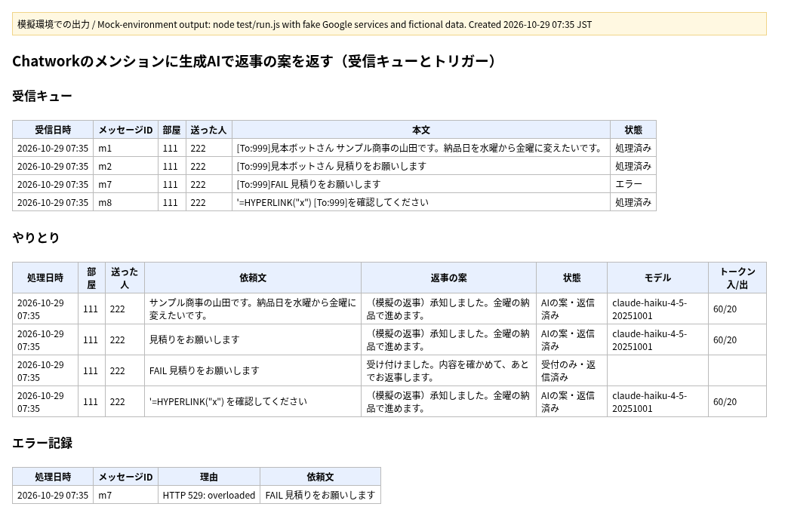

# Chatwork のメンションに、生成AIで返事の案を返す（Google Apps Script の見本）

Chatwork で自分あてに届いた依頼文を GAS で受け取り、生成AIのAPIで返事の案を作って同じ部屋に返信し、やりとりを Google スプレッドシートに残す仕組みの見本です。

**画像について：** 上の画像は `node test/run.js` を模擬環境で動かした出力です。Google のサービス、生成AIのAPI、Chatwork のAPIは偽物に置きかえていて、本物にはつないでいません。返事の案も、偽物のAPIが返す決まった文です。

**変わること：** 依頼文と返事の案が、あとからシートで追えるようになります。

## 流れ
1. スクリプトをウェブアプリとして公開し、その URL を Chatwork の Webhook の URL に設定する
2. `doPost` が Chatwork の署名を確かめる（下の「署名の確かめ方」）。合わなければ何もしない
3. 自分あての文だけを選ぶ。`mention_to_me` は宛先が自分のとき、`message_created` は本文に `[To:自分のID]` があるときだけ。自分が送った文は選ばない
4. 選んだ文を「受信キュー」シートに「未処理」として入れて、すぐ応答を返す
5. 1分おきの時間主導型トリガーで `processQueue` が動き、「未処理」の文を1回に5件まで処理する
   - `[To:...]` などの記号と宛名を取り除き、`UrlFetchApp` で生成AIのAPI（この見本は Anthropic の Messages API）に送る
   - Chatwork のAPIで、送った人への返信の形で同じ部屋に投稿する
   - 処理日時・部屋・送った人・依頼文・返事の案・状態・モデル・トークン数を「やりとり」に記録し、キューを「処理済み」にする

## 設定
1. スプレッドシートの「拡張機能 > Apps Script」で、`src/` のファイル（`appsscript.json` も）を入れる
2. 「プロジェクトの設定 > スクリプト プロパティ」に次を入れる
   - `CHATWORK_WEBHOOK_TOKEN`：Chatwork の Webhook 編集画面に出るトークン
   - `CHATWORK_MY_ACCOUNT_ID`：返信するアカウントのID（空のままだと何も処理しません）
   - `CHATWORK_TOKEN`：そのアカウントの Chatwork APIトークン
   - `AI_API_KEY`：生成AIのAPIキー
   キーとトークンはスクリプトプロパティからだけ読みます。コードやシートには書きません。
3. Apps Script のエディタで `installTrigger` を1回実行し、`processQueue` の1分おきのトリガーを作る
4. 必要なら `src/Config.gs` でモデル、指示文、1回の件数、長さの上限、シート名を変える
5. 「デプロイ > 新しいデプロイ > ウェブアプリ」で公開し、その URL を Chatwork の Webhook の URL に設定する（イベントは「自分へのメンション」か「メッセージ作成」）

## 作りの工夫
- **署名の確かめ方：** Chatwork の開発者向けの説明（https://developer.chatwork.com/docs/webhook ）のとおり、Webhook のトークンを Base64 でデコードした値を鍵にして、受け取った本文そのままの HMAC-SHA256 を取り、Base64 にした値が署名と一致するかを比べます。GAS の `doPost` はリクエストのヘッダーを読めないため、ヘッダー（`x-chatworkwebhooksignature`）ではなく、同じ説明で「ヘッダーと同じ内容」とされているリクエストパラメーター `chatwork_webhook_signature` を `e.parameter` から読んでいます。このパラメーターが本物の Chatwork から GAS にどう届くかは、本物の環境ではまだ試していません。テストでは、決まりどおりに作った署名で確かめています。
- **すぐ応答を返す：** Chatwork は10秒以内の応答を求め、失敗しても再送しません。そのため `doPost` はキューに入れるだけにして、時間のかかるAIの呼び出しと返信はトリガー側で行います。
- **二重の処理を防ぐ：** 同じメッセージIDはキューに1回だけ入ります。処理中・処理済み・エラーの文は、自動ではやり直さないので、APIが二重に課金されることもありません。
- **自分の返信を飛ばす：** 返信したアカウントの文は選ばないので、返信がくり返されることはありません。
- **AIのAPIが失敗したとき：** 理由を「エラー記録」に残し、部屋には「受け付けました。内容を確かめて、あとでお返事します。」だけを返します。
- 同時の処理は `LockService` で1つずつにしています。長い文は `CONFIG.maxInputChars` で切ってから送ります。`=` などで始まる値は数式ではなく文字として記録します。
- 別の生成AIのサービスに替えるときは、`draftReply_`・`buildRequest_`・`parseResponse_` だけを変えます。

## ファイル
| ファイル | 役目 |
|---|---|
| `src/Config.gs` | 案件ごとに変える設定 |
| `src/Lib.gs` | Google のサービスを使わない処理（読み取り、選び方、記号の除去、署名の比較など） |
| `src/Main.gs` | 受け口、署名の確かめ、キューの処理、AIのAPIと Chatwork の呼び出し、トリガーの作成 |
| `test/run.js` | 模擬環境のテスト。偽物のサービスは `test/mock_gas.js` |
| `tools/render_png.py` | テストの出力から上の画像を作る |

## テスト
- `node test/run.js` で24件を確かめます（ネットにつながず、キーもいりません）。24件すべて OK です。
- テストの文に出てくる会社名・人名（サンプル商事の山田など）は、テスト用の架空のものです。

## ライセンス
MIT
